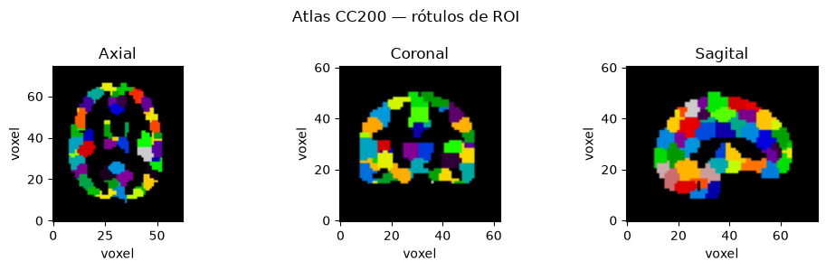
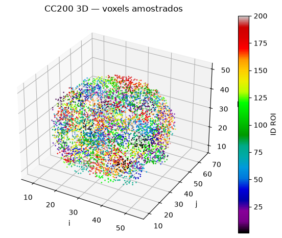
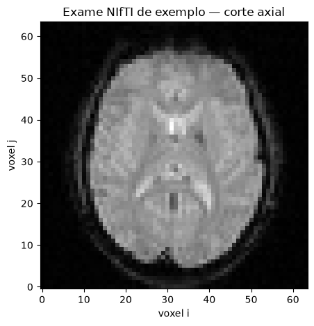
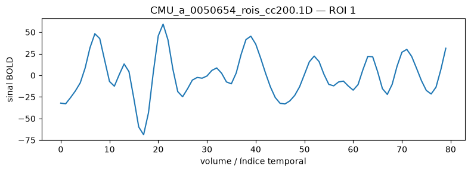
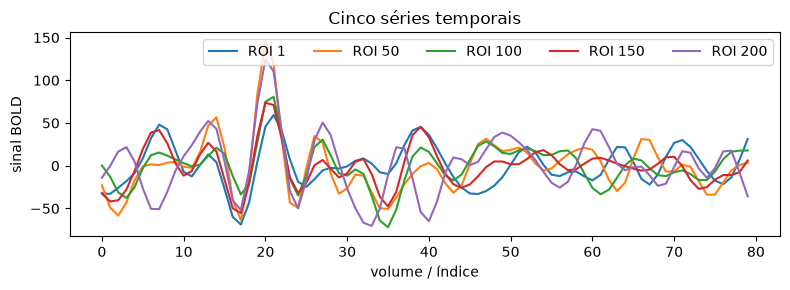
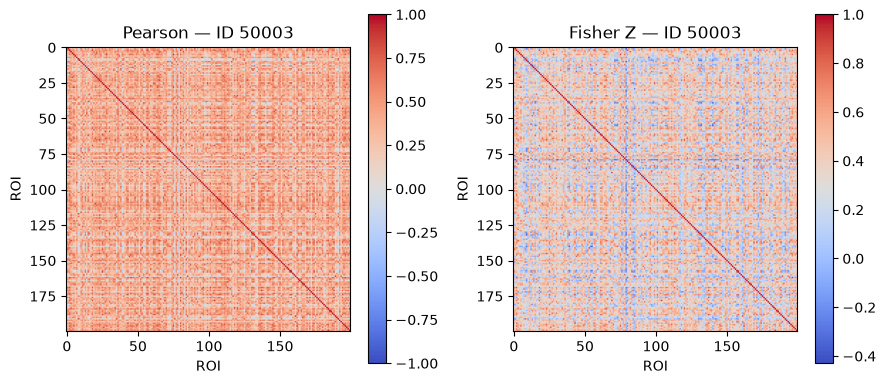
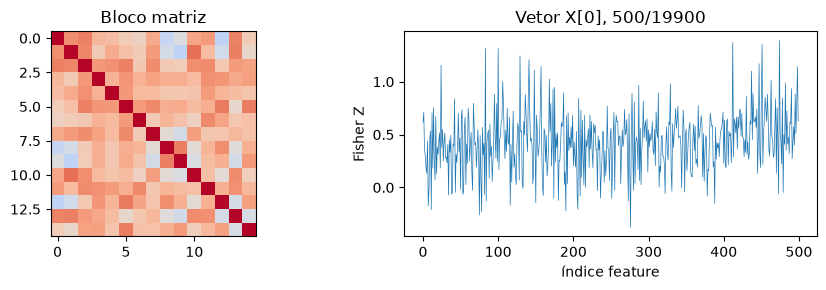
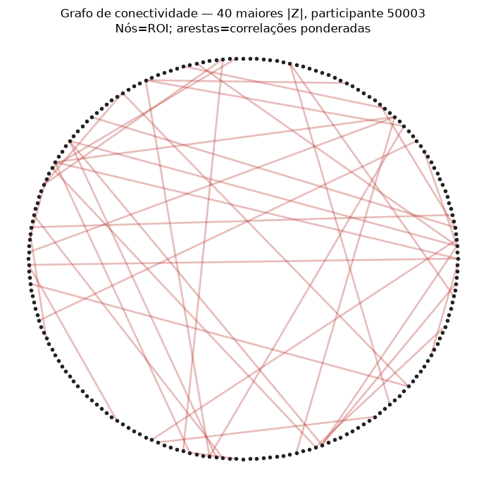
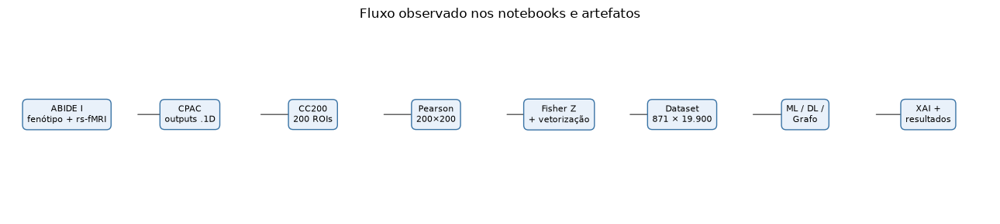
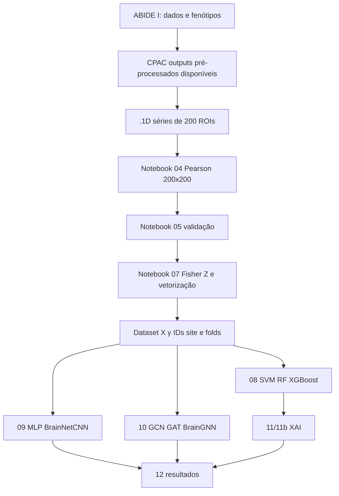

# Auditoria completa — projeto TCC TEA / ABIDE I

Gerada em 07/11/2026 a partir do conteúdo local. Arquivos originais não foram alterados. Pickles foram desserializados sequencialmente; valores apresentados são observados, não estimados. “Inferência” indica origem não comprovada por log.

## Sumário
1. Resumo e inventário
2. Anatomia dos dados
3. Cronologia e matemática
4. Contagens
5. Auditoria dos 13 notebooks
6. Resultados, glossário e inconsistências

## Resumo e inventário

Foram listados 48575 arquivos recursivamente. Há 13 notebooks, 871 arquivos .1D no diretório CPAC, dois CSV de fenótipo e os artefatos centrais abaixo. Dataset final tem 871 participantes, X=(871, 19900), distribuição codificada {0: 468, 1: 403}, cinco folds.

As pastas do projeto são Data/raw, Data/roi_timeseries, Data/conectivity (grafia física), Data/processed, notebooks, src, Models, Results, Figures e Docs. `INVENTARIO_ARQUIVOS.csv` tem cada caminho, tamanho, extensão e dimensões quando aplicável.

## Anatomia dos dados

### NIfTI-1, voxel e atlas CC200

CC200.nii é imagem NIfTI-1: cabeçalho armazena dimensão, tipo de dado e transformações espaciais; os dados são voxels 3D. Shape (63, 75, 61), dtype int16, 200 valores inteiros positivos. ROI é parcela/conjunto de voxels; o atlas mostra IDs, não nomes anatômicos. Affine:

```text
[[  -3.125         0.            0.          100.        ]
 [   0.            3.125         0.         -100.60289001]
 [   0.            0.            4.          -18.43025208]
 [   0.            0.            0.            1.        ]]
```


Figura 1 — cortes axial, coronal e sagital em eixos de voxel.


Figura 2 — voxels rotulados do atlas em nuvem 3D amostrada.

Exame de exemplo `CC200.nii` não é esse atlas: arquivo separado Data/raw/exemplo_raw_sem_processamento.nii.gz, shape (64, 64, 29, 200), dtype int16.


Figura 3 — fatia axial central no tempo médio do exemplo volumétrico.

### CPAC .1D

Amostra `Data/raw/ABIDE_pcp/cpac/filt_noglobal/CMU_a_0050654_rois_cc200.1D` tem 236 linhas × 200 colunas; primeira linha do arquivo traz cabeçalho #1…#200; separador tab. As colunas representam séries de 200 ROIs, linhas representam frames/volumes. Valores iniciais da linha 1: [-32.1578, -14.4711, -13.0393, -7.8936, -8.413]. O caminho `filt_noglobal` sugere filtragem sem regressão global pelo rótulo do output; os parâmetros completos não aparecem neste artefato.


Figura 4 — ROI 1, x índice temporal, y sinal BOLD exportado.


Figura 5 — cinco séries reais em ROIs diferentes.

### Pickles

- roi_timeseries_abide.pkl é dict ID→array; 871 chaves; shapes observados [(78, 200), (116, 200), (124, 200), (146, 200), (152, 200), (176, 200), (196, 200), (202, 200), (206, 200), (232, 200), (236, 200), (246, 200)]; linhas são tempo e colunas são 200 ROIs.
- connectivity_matrices_abide.pkl: dict de 871 matrizes; Notebook 04 usa ConnectivityMeasure(kind=correlation), Pearson.
- connectivity_matrices_abide_validado.pkl: dict de 871 matrizes. Notebook 07 registra Fisher Z e checagens; uma amostra de matriz tem shape (200, 200). Equal size does not prove byte equality.


Figura 6 — matrizes reais de uma pessoa; cada célula (i,j) conecta sinais de duas ROIs.

- dataset_abide_processado.pkl: dict com ['atlas', 'n_rois', 'n_features', 'ordem_atributos', 'fisher_z'] mais X/y/groups/sub_ids/folds. X (871, 19900), y (871,), IDs e sites alinhados; metadados {'atlas': 'CC200', 'n_rois': 200, 'n_features': 19900, 'ordem_atributos': 'triu_linha', 'fisher_z': True}; sujeito inicial: ID 50003, site PITT, y=1, X[0][:8]=[0.6177, 0.71, 0.3547, 0.303, 0.1824, 0.135, 0.4399, -0.173].


Figura 7 — matriz e primeiras 500 das 19.900 features reais.



Figura 8 — grafo derivado da matriz Fisher Z real do participante 50003: cada nó é ROI; as 40 arestas desenhadas são as conexões de maior magnitude absoluta, vermelho positivo e azul negativo. Este recorte é visualização didática; não define a adjacência dos modelos.



Figura 9 — caminho resumido dos dados conforme os notebooks e artefatos locais.

## Cronologia e transformações



Notebook 02 chama `nilearn.datasets.fetch_abide_pcp`; 03 explora; 04 calcula conectividade; 05 valida; 07 constrói features e folds; 08–10 treinam/avaliam; 11/11b interpretam; 12 consolida. CPAC está presente como dados de saída; logs/configuração total não foram encontrados, então sua execução histórica local é não comprovada.

### Fórmulas didáticas

1. Série temporal ROI: x_k(t) é resumo do sinal dos voxels da ROI k no frame t. Aqui .1D já traz as séries.
2. Pearson: r_ij=Σ(x_i−m_i)(x_j−m_j)/√[Σ(x_i−m_i)²Σ(x_j−m_j)²]. Exemplo [1,2,3] e [2,4,6] resulta r=1.
3. Matriz de conectividade é simétrica 200×200, diagonal Pearson=1; há 19.900 pares distintos.
4. Fisher Z: z=0.5 ln((1+r)/(1-r))=arctanh(r); r=0.5 → z≈0.549.
5. Vetorização retém posições i<j, elimina diagonal e redundância espelhada. 200×199/2=19.900; a ordem declarada é `triu_linha`.
6. Normalização: SVM tem StandardScaler em Pipeline em src/avaliacao.py; parâmetros devem vir do treino. Árvores não precisam mesma escala; PCA do Notebook 06 é exploratória.
7. Grafo: nó=ROI, aresta=peso entre ROIs. Notebook 10 usa matrizes para modelos de grafos; a Figura 8 é uma visualização didática das 40 maiores conexões absolutas, não a adjacência exata do treinamento.

## Contagens

| Etapa | n | Evidência/limite |
|---|---:|---|
| Arquivos .1D locais | 871 | diretório CPAC, pode ser subconjunto |
| Séries no pickle | 871 | estrutura desserializada |
| Pearson | 871 | estrutura desserializada |
| Matrizes validadas | 871 | estrutura desserializada |
| Dataset final | 871 | classes {0: 468, 1: 403}, X (871, 19900) |
| Participantes nos treinamentos | Results/OOF | contagem depende de notebook e saída; não reexecutado |

Não foi localizado manifesto completo de download nem tabela de perdas por etapa. IDs de pickles podem usar namespace diferente de SUB_ID; total inicial e distribuição diagnóstica entre cada transformação ficam não confirmados. Não invento esses totais.

### Verificação de correspondência de IDs

As chaves dos três pickles intermediários foram comparadas com `sub_ids` do dataset final, após conversão textual uniforme. As quatro coleções têm 871 IDs e correspondência exata: séries temporais ↔ Pearson = 0 divergentes; Pearson ↔ validado = 0; validado ↔ dataset = 0; séries ↔ dataset = 0. Não há duplicatas dentro das chaves dos dicionários; `sub_ids` do dataset também é único. Assim, a perda entre esses artefatos é zero no estado local. Isso não recupera perdas anteriores ao pickle nem o universo originalmente baixado.

## Auditoria dos notebooks

Contagens de execution_count/outputs são metadados dos arquivos atuais, não provam execução reproduzível. Índices de célula são zero-based.

### 01. `01_Configuracao.ipynb`
- Objetivo/tema: 01 — Configuração do ambiente — TEA.
- Células: 13; código executado: 6; células com outputs: 6.
- Operações/células: célula 5: criar_pastas(); célula 7: import sys; célula 9: from src.utils import definir_sementes; célula 11: import shutil; célula 12: print('Ambiente configurado.')
- Entradas, dependências e arquivos produzidos: os caminhos citados nas células estão no próprio notebook; papel no fluxo é indicado na cronologia. Saídas salvas relevantes aparecem no inventário Results/Figures/Data.

### 02. `02_Download_ABIDE.ipynb`
- Objetivo/tema: 02 — Download dos Dados ABIDE.
- Células: 10; código executado: 6; células com outputs: 6.
- Operações/células: célula 3: import pickle; célula 5: from nilearn.datasets import fetch_abide_pcp
- Entradas, dependências e arquivos produzidos: os caminhos citados nas células estão no próprio notebook; papel no fluxo é indicado na cronologia. Saídas salvas relevantes aparecem no inventário Results/Figures/Data.

### 03. `03_Exploracao_ABIDE.ipynb`
- Objetivo/tema: 03 — Exploração do Dataset ABIDE I — TEA.
- Células: 20; código executado: 12; células com outputs: 12.
- Operações/células: célula 5: tabela_cruzada = pd.crosstab(; célula 9: import requests; célula 10: import matplotlib.pyplot as plt; célula 12: from nilearn.datasets import fetch_abide_pcp; célula 14: import urllib.request; célula 16: exigir_arquivo(PATHS['roi_timeseries'] / 'roi_timeseries_abide.pkl', '02_Download_ABIDE.ipynb'); célula 19: import pandas as pd
- Entradas, dependências e arquivos produzidos: os caminhos citados nas células estão no próprio notebook; papel no fluxo é indicado na cronologia. Saídas salvas relevantes aparecem no inventário Results/Figures/Data.

### 04. `04_Conectividade_ABIDE.ipynb`
- Objetivo/tema: 04_Conectividade_ABIDE.
- Células: 9; código executado: 5; células com outputs: 5.
- Operações/células: célula 1: import sys; célula 4: conn_measure = ConnectivityMeasure(kind='correlation')
- Entradas, dependências e arquivos produzidos: os caminhos citados nas células estão no próprio notebook; papel no fluxo é indicado na cronologia. Saídas salvas relevantes aparecem no inventário Results/Figures/Data.

### 05. `05_Validacao_ABIDE.ipynb`
- Objetivo/tema: 05_Validacao_ABIDE.
- Células: 7; código executado: 5; células com outputs: 5.
- Operações/células: sem operação de código identificável.
- Entradas, dependências e arquivos produzidos: os caminhos citados nas células estão no próprio notebook; papel no fluxo é indicado na cronologia. Saídas salvas relevantes aparecem no inventário Results/Figures/Data.

### 06. `06_Analise_Exploratoria_ABIDE.ipynb`
- Objetivo/tema: 06_Analise_Exploratoria_ABIDE.
- Células: 9; código executado: 5; células com outputs: 5.
- Operações/células: sem operação de código identificável.
- Entradas, dependências e arquivos produzidos: os caminhos citados nas células estão no próprio notebook; papel no fluxo é indicado na cronologia. Saídas salvas relevantes aparecem no inventário Results/Figures/Data.

### 07. `07_Preparacao_Dados_ABIDE.ipynb`
- Objetivo/tema: 07_Preparacao_Dados_ABIDE.
- Células: 6; código executado: 5; células com outputs: 5.
- Operações/células: sem operação de código identificável.
- Entradas, dependências e arquivos produzidos: os caminhos citados nas células estão no próprio notebook; papel no fluxo é indicado na cronologia. Saídas salvas relevantes aparecem no inventário Results/Figures/Data.

### 08. `08_Baselines_ABIDE.ipynb`
- Objetivo/tema: 08 — Baselines clássicos (TEA): SVM, Random Forest e XGBoost (protocolo revisado).
- Células: 8; código executado: 7; células com outputs: 7.
- Operações/células: sem operação de código identificável.
- Entradas, dependências e arquivos produzidos: os caminhos citados nas células estão no próprio notebook; papel no fluxo é indicado na cronologia. Saídas salvas relevantes aparecem no inventário Results/Figures/Data.

### 09. `09_Modelo_Deep_Learning.ipynb`
- Objetivo/tema atual: 09 — MLP e BrainNetCNN. 
- Células: 8; código executado: 7; células com outputs: 6.
- Operações/células: sem operação de código identificável.
- Entradas, dependências e arquivos produzidos: os caminhos citados nas células estão no próprio notebook; papel no fluxo é indicado na cronologia. Saídas salvas relevantes aparecem no inventário Results/Figures/Data.

### 10. `10_Modelos_Grafos_ABIDE.ipynb`
- Objetivo/tema atual: 10 — Modelos de grafos (TEA): GCN, GAT e BrainGNN. 
- Células: 5; código executado: 4; células com outputs: 3.
- Operações/células: sem operação de código identificável.
- Entradas, dependências e arquivos produzidos: os caminhos citados nas células estão no próprio notebook; papel no fluxo é indicado na cronologia. Saídas salvas relevantes aparecem no inventário Results/Figures/Data.

### 11. `11_XAI_ABIDE.ipynb`
- Objetivo/tema: 11 — Explicabilidade (TEA): o que o modelo usa, e se isso é estável.
- Células: 8; código executado: 6; células com outputs: 6.
- Operações/células: sem operação de código identificável.
- Entradas, dependências e arquivos produzidos: os caminhos citados nas células estão no próprio notebook; papel no fluxo é indicado na cronologia. Saídas salvas relevantes aparecem no inventário Results/Figures/Data.

### 12. `11b_Importancia_XGBoost_ABIDE.ipynb`
- Objetivo/tema: 11b — Importância das conexões com XGBoost (TEA / ABIDE I).
- Células: 7; código executado: 5; células com outputs: 5.
- Operações/células: sem operação de código identificável.
- Entradas, dependências e arquivos produzidos: os caminhos citados nas células estão no próprio notebook; papel no fluxo é indicado na cronologia. Saídas salvas relevantes aparecem no inventário Results/Figures/Data.

### 13. `12_Resultados_Finais_ABIDE.ipynb`
- Objetivo/tema: 12 — Resultados finais (TEA): consolidação dos notebooks 08, 09 e 10.
- Células: 10; código executado: 8; células com outputs: 7.
- Operações/células: sem operação de código identificável.
- Entradas, dependências e arquivos produzidos: os caminhos citados nas células estão no próprio notebook; papel no fluxo é indicado na cronologia. Saídas salvas relevantes aparecem no inventário Results/Figures/Data.

## Resultados e glossário

Results contém CSVs de métrica/fold, NPZ de OOF, tabelas finais e feature importances; Figures tem plots. Notebook 08: SVM/RF/XGBoost; 09 atual: MLP/BrainNetCNN; 10 atual: GCN/GAT/BrainGNN; 11: permutação/XAI; 11b: Gain/Weight/Cover; 12 consolida. Predições OOF são fora do fold de teste. Importance explica dependência preditiva, não causalidade.

- **Neuroimagem.** imagem do sistema nervoso.
- **fMRI/rs-fMRI.** MRI funcional; rs indica repouso.
- **NIfTI-1.** formato de volume com cabeçalho e voxels.
- **Voxel.** elemento de volume 3D.
- **Atlas/CC200.** mapa de 200 ROIs.
- **ROI.** região de interesse, conjunto de voxels.
- **Série temporal.** sinal da ROI ao longo de frames.
- **Conectividade funcional.** associação temporal entre sinais.
- **Pearson.** correlação linear entre -1 e 1.
- **Fisher Z.** arctanh de Pearson.
- **Adjacência.** matriz de pesos do grafo.
- **Feature.** variável de entrada; aqui conexão.
- **Vetorização.** transformar matriz em sequência.
- **Pickle.** serialização Python.
- **Normalização.** reescalar features com parâmetros de treino.
- **CV por centro.** manter centros inteiros separados.
- **XGBoost.** boosting de árvores.
- **SVM.** classificador de margem; RBF não linear.
- **PCA.** projeção linear exploratória.
- **GCN/GAT.** redes neurais convolucionais/atenção em grafos.
- **SHAP/Feature Importance.** atribuição de efeito preditivo, não causal.

## Inconsistências e limites

- Pasta física Data/conectivity, grafia discrepante de connectivity no pedido.
- Download é demonstrado por chamada no Notebook 02; não há logs de downloads completos ou execução CPAC.
- Amostras .1D locais não comprovam universo de todos 871; dataset final maior que amostra local possivelmente por dados removidos/arquivos ausentes em disco.
- Sem hash ou registro de versão, resultados salvos podem vir de execução anterior à revisão atual do Notebook 07.
- Atlas guarda índices, não nomes anatômicos; nomes não inventados.
- O inventário é completo para arquivos físicos visíveis fora do .git e da própria pasta de entrega; dimensão não decodificada fica vazia.


## Atualização do roster de modelos (2026-11)

O fluxo atual usa MLP/BrainNetCNN e GCN/GAT/BrainGNN. Os arquivos e resultados de CNN/ResNet50 foram removidos a pedido. Os resultados restantes de SVM/RF/XGBoost e GCN/GAT permanecem disponíveis. Ainda não há métricas OOF de TEA para MLP, BrainNetCNN ou BrainGNN até que a bateria correspondente seja treinada.
